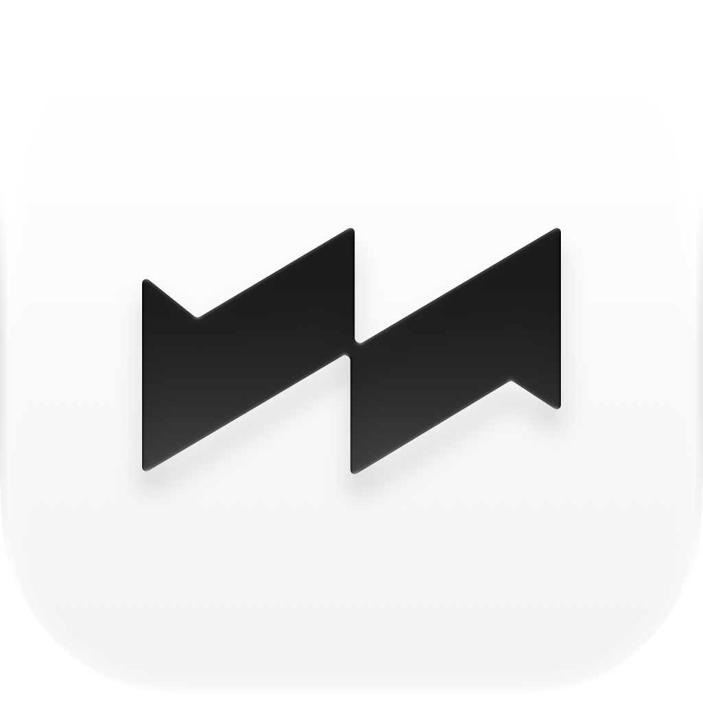
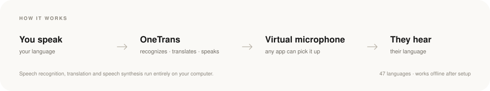

<b>English</b> · <a href="README.zh-CN.md">简体中文</a>

  

<h1 align="center">OneTrans</h1>

  <strong>Speak your language. Your meeting hears theirs.</strong> 
  Real-time voice translation that runs on your own computer — and shows up 
  in Zoom, Google Meet, Microsoft Teams and Discord as a microphone.

  
  
  
  

  

  
  &nbsp;&nbsp;
  

  macOS 13.3+ · Apple silicon&nbsp;&nbsp;·&nbsp;&nbsp;Windows 10/11 · 64-bit&nbsp;&nbsp;·&nbsp;&nbsp;Free plan available

---

OneTrans turns your voice into the listener's language as you speak. Speech recognition, translation and speech synthesis all run on your machine, and the translated voice is played into a **virtual microphone** — so any meeting app can pick it up. No bots, no plugins, no cloud in the middle.

The same toolkit translates screenshots, selected text and anything you type, and floats bilingual subtitles over any window.

Built for meetings and sales calls, online classes, live streams, and watching anything in a language you don't speak.

## Highlights

<table>
  <tr>
    <td width="50%" valign="top"><strong>Live translation, both ways</strong> Your microphone and the meeting can run at the same time, each with its own language pair and voice.</td>
    <td width="50%" valign="top"><strong>Bilingual subtitles, anywhere</strong> Float original and translated captions over a call, a video player or any other app.</td>
  </tr>
  <tr>
    <td width="50%" valign="top"><strong>Screenshot &amp; selection translation</strong> Press a hotkey, select a region or some text, and read the translation in place.</td>
    <td width="50%" valign="top"><strong>Input-box translation</strong> Write in your language in any text field and send it in theirs.</td>
  </tr>
  <tr>
    <td width="50%" valign="top"><strong>Your voice, any language</strong> Clone your voice from a short sample, so the translation keeps your timbre and tone.</td>
    <td width="50%" valign="top"><strong>Voice input, anywhere</strong> Hold the hotkey, speak, and the text — translated first if you want — is typed where your cursor is.</td>
  </tr>
  <tr>
    <td width="50%" valign="top"><strong>47 languages</strong> From Japanese to Turkish, every pair runs locally. Each route keeps its own language pair.</td>
    <td width="50%" valign="top"><strong>Private by design</strong> No cloud, no telemetry. Your audio never leaves your device.</td>
  </tr>
</table>

### See it in action

  

<table>
  <tr>
    <td width="50%" align="center" valign="top">
       
      Bilingual subtitles, anywhere
    </td>
    <td width="50%" align="center" valign="top">
       
      Your voice, any language
    </td>
  </tr>
  <tr>
    <td width="50%" align="center" valign="top">
       
      Screenshot &amp; selection translation, in place
    </td>
    <td width="50%" align="center" valign="top">
       
      Voice input, anywhere
    </td>
  </tr>
</table>

## How it works

  

## Install

### macOS

1. Download the latest `.dmg` from [Releases](https://github.com/OneTrans/download/releases/latest).
2. Open it and drag **OneTrans** into **Applications** — the app updates itself in place, so it must live in a writable folder.
3. Launch OneTrans. Setup asks for your language pair, then offers to install the **OneTrans virtual sound card** (macOS asks for your administrator password once).
4. In your meeting app, choose a **OneTrans Loopback** device as the microphone. OneTrans translates whatever you route into it.

macOS 13.3 or later on Apple silicon is required. Intel Macs are not supported. See the [installation guide](https://onetrans.app/en/docs/getting-started/installation) for permissions and details.

### Windows

1. Download the latest `*-setup-*.exe` from [Releases](https://github.com/OneTrans/download/releases/latest).
2. Run it. OneTrans installs for your user account in `%LOCALAPPDATA%\Programs\OneTrans`, with no administrator rights needed. If SmartScreen appears, choose **More info → Run anyway**.
3. Install the free [VB-CABLE](https://vb-audio.com/Cable/) virtual audio device — Windows needs it to give OneTrans a microphone that other apps can use.
4. In OneTrans, choose **CABLE Input** as the route's output; in your meeting app, choose **CABLE Output** as the microphone.

Windows 10 or 11, 64-bit, is required. Windows on ARM is not supported. See the [installation guide](https://onetrans.app/en/docs/getting-started/installation#windows) for the full walkthrough.

## System requirements

| | macOS | Windows |
|:--|:--|:--|
| **OS** | macOS 13.3 (Ventura) or later | Windows 10 or 11, 64-bit |
| **Processor** | Apple silicon (M1 or later) | x64 (Intel or AMD) |
| **Memory** | 8 GB minimum, 16 GB recommended | 8 GB minimum, 16 GB recommended |
| **Virtual microphone** | Built in — installed by OneTrans | [VB-CABLE](https://vb-audio.com/Cable/), free |
| **Disk** | About 350 MB for the app; 1.5–5 GB with models | About 350 MB for the app; 1.5–5 GB with models |

Models are downloaded on demand, and translation works offline once they are installed. Internet is needed only for sign-in, model downloads and update checks.

## Updates

OneTrans checks this repository's [latest release](https://github.com/OneTrans/download/releases/latest) shortly after launch and once a day. Updates are verified with OneTrans's Ed25519 update key, then install in place. You can also check by hand from the tray menu or **Settings → About**.

## FAQ

**Is my audio sent to a server?**  
No. Speech recognition, translation and speech synthesis run locally. OneTrans ships no telemetry.

**Does it work with my meeting app?**  
Yes, if the app lets you choose a microphone. That includes Zoom, Google Meet, Microsoft Teams, Discord, Slack, OBS and most others.

**Do I need an account?**  
Yes — a free OneTrans account is used for sign-in and plan management. The free plan has no time limit. [Compare plans](https://onetrans.app/en/pricing).

**Does it work offline?**  
After the models for your languages are downloaded, yes. Only sign-in, model downloads, plan checks and update checks need the internet.

## Links

[Website](https://onetrans.app) · [Documentation](https://onetrans.app/en/docs) · [Changelog](https://onetrans.app/en/changelog) · [Pricing](https://onetrans.app/en/pricing) · [Discord](https://discord.gg/KgnmVjxWNb) · [Support](mailto:support@onetrans.app)

## About this repository

This is the official distribution repository for OneTrans. It hosts the installers, the update manifests and archives the app updates from, and delta updates for recent versions. The application's source code is private.

- macOS builds are signed with an Apple Developer ID and notarized by Apple; every update archive is signed with OneTrans's update key.
- Please keep old releases published: delta updates are built from the archives of the previous versions.
- OneTrans is proprietary software. Use is governed by the [Terms of Service](https://onetrans.app/terms); see [LICENSE](LICENSE).

© 2026 OneTrans. All rights reserved.
