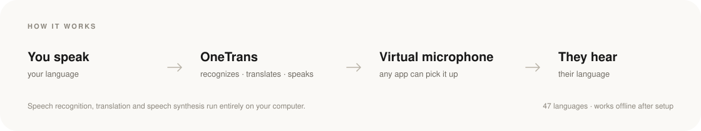

<a href="README.md">English</a> · <b>简体中文</b>

  

<h1 align="center">OneTrans</h1>

  <strong>说你熟悉的语言，让会议听到对方的语言。</strong> 
  完全在你自己的电脑上运行的实时语音翻译，在 Zoom、Google Meet、 
  Microsoft Teams、Discord 里以一个麦克风的形式出现。

  
  
  
  

  

  
  &nbsp;&nbsp;
  

  macOS 13.3+ · Apple 芯片&nbsp;&nbsp;·&nbsp;&nbsp;Windows 10/11 · 64 位&nbsp;&nbsp;·&nbsp;&nbsp;提供免费版

---

OneTrans 在你说话的同时，把你的声音变成对方听得懂的语言。语音识别、翻译和语音合成全部在你的电脑上完成，翻译后的声音会送进一个**虚拟麦克风**，任何会议软件都能直接选用——不需要机器人、插件，也不经过云端。

同一套工具还能翻译截图、选中的文字和输入框里的内容，并把双语字幕浮在任何窗口之上。

适合会议与销售通话、在线课堂、直播，以及观看任何非母语内容。

## 功能

<table>
  <tr>
    <td width="50%" valign="top"><strong>双向实时翻译</strong> 你的麦克风和会议声音可以同时翻译，各自使用独立的语言对和音色。</td>
    <td width="50%" valign="top"><strong>双语字幕，浮在任何窗口上</strong> 在通话、播放器或任何应用上显示原文与译文。</td>
  </tr>
  <tr>
    <td width="50%" valign="top"><strong>截图与选词翻译</strong> 按下快捷键，框选一块区域或一段文字，译文就地显示。</td>
    <td width="50%" valign="top"><strong>输入框翻译</strong> 用中文写，发出去的是对方的语言。</td>
  </tr>
  <tr>
    <td width="50%" valign="top"><strong>你的声音，说任何语言</strong> 用一小段录音克隆音色，翻译后依然是你。</td>
    <td width="50%" valign="top"><strong>语音输入，说进任何应用</strong> 按住快捷键说话，文字会输入到光标所在的位置，需要时可以先翻译。</td>
  </tr>
  <tr>
    <td width="50%" valign="top"><strong>47 种语言</strong> 从日语到土耳其语，所有语言对都在本机运行，每条链路都可以单独设置。</td>
    <td width="50%" valign="top"><strong>隐私优先</strong> 没有云端，没有遥测，声音不会离开你的设备。</td>
  </tr>
</table>

### 功能一览

  

<table>
  <tr>
    <td width="50%" align="center" valign="top">
       
      双语字幕，浮在任何窗口上
    </td>
    <td width="50%" align="center" valign="top">
       
      你的声音，说任何语言
    </td>
  </tr>
  <tr>
    <td width="50%" align="center" valign="top">
       
      截图与选词翻译，就地显示
    </td>
    <td width="50%" align="center" valign="top">
       
      语音输入，说进任何应用
    </td>
  </tr>
</table>

## 工作原理

  

## 安装

### macOS

1. 从 [Releases](https://github.com/OneTrans/download/releases/latest) 下载最新的 `.dmg`。
2. 打开后把 **OneTrans** 拖进**应用程序**文件夹——应用需要原地自动更新，所以要放在可写的目录里。
3. 打开 OneTrans。首次启动会让你选择语言，然后引导你安装 **OneTrans 虚拟声卡**（macOS 会要求输入一次管理员密码）。
4. 在会议软件里把麦克风选为 **OneTrans Loopback** 设备。送进这个设备的声音会被 OneTrans 翻译后播放出去。

需要 macOS 13.3 或更高版本，以及 Apple 芯片（M1 及以后）。不支持 Intel Mac。权限说明和更多细节见[安装文档](https://onetrans.app/zh/docs/getting-started/installation)。

### Windows

1. 从 [Releases](https://github.com/OneTrans/download/releases/latest) 下载最新的 `*-setup-*.exe`。
2. 直接运行。OneTrans 会以当前用户身份安装到 `%LOCALAPPDATA%\Programs\OneTrans`，不需要管理员权限。如果出现 SmartScreen 提示，选择**更多信息 → 仍要运行**。
3. 安装免费的 [VB-CABLE](https://vb-audio.com/Cable/) 虚拟声卡——Windows 需要它来提供其他应用能使用的麦克风。
4. 在 OneTrans 里把线路输出设为 **CABLE Input**；在会议软件里把麦克风设为 **CABLE Output**。

需要 64 位的 Windows 10 或 Windows 11，不支持 Windows on ARM。完整步骤见[安装文档](https://onetrans.app/zh/docs/getting-started/installation#windows)。

## 系统要求

| | macOS | Windows |
|:--|:--|:--|
| **系统** | macOS 13.3（Ventura）或更高 | Windows 10 / 11，64 位 |
| **处理器** | Apple 芯片（M1 及以后） | x64（Intel 或 AMD） |
| **内存** | 最低 8 GB，推荐 16 GB | 最低 8 GB，推荐 16 GB |
| **虚拟麦克风** | 内置，由 OneTrans 安装 | [VB-CABLE](https://vb-audio.com/Cable/)，免费 |
| **磁盘** | 应用约 350 MB；含模型约 1.5–5 GB | 应用约 350 MB；含模型约 1.5–5 GB |

模型按需下载，装好之后翻译可以离线进行。只有登录、下载模型和检查更新需要联网。

## 更新

OneTrans 会在启动后不久检查一次本仓库的[最新发布](https://github.com/OneTrans/download/releases/latest)，之后每天一次。更新包会先用 OneTrans 的 Ed25519 更新密钥验签，然后原地安装。你也可以从托盘菜单或**设置 → 关于**手动检查。

## 常见问题

**声音会上传到服务器吗？**  
不会。语音识别、翻译和语音合成都在本机完成，OneTrans 也不包含任何遥测。

**支持哪些会议软件？**  
只要能选择麦克风就可以，包括 Zoom、Google Meet、Microsoft Teams、Discord、Slack、OBS 等。

**需要账号吗？**  
需要，免费账号用于登录和套餐管理。免费版没有时间限制，[对比套餐](https://onetrans.app/zh/pricing)。

**可以离线使用吗？**  
把对应语言的模型下载好之后可以。只有登录、下载模型、套餐校验和检查更新需要联网。

## 链接

[官网](https://onetrans.app/zh) · [文档](https://onetrans.app/zh/docs) · [更新日志](https://onetrans.app/zh/changelog) · [价格](https://onetrans.app/zh/pricing) · [Discord](https://discord.gg/KgnmVjxWNb) · [联系支持](mailto:support@onetrans.app)

## 关于本仓库

这里是 OneTrans 的官方分发仓库，存放官方安装包、应用自动更新使用的清单与压缩包，以及最近几个版本的增量更新。应用源码不公开。

- macOS 版本经过 Developer ID 签名和 Apple 公证；每个更新包都用 OneTrans 的更新密钥签名。
- 请保留历史 Release：增量更新需要用旧版本的压缩包来生成。
- OneTrans 是专有软件，使用受[服务条款](https://onetrans.app/zh/terms)约束，详见 [LICENSE](LICENSE)。

© 2026 OneTrans. All rights reserved.
